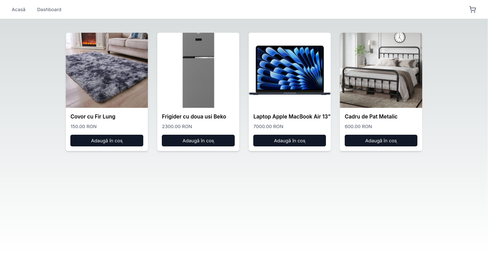
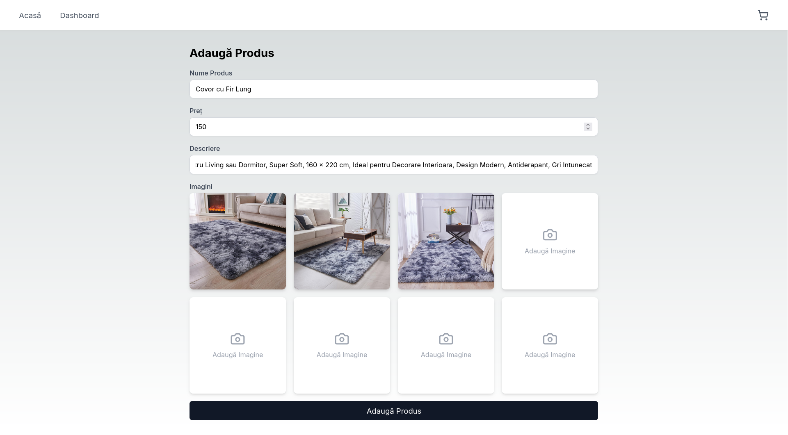
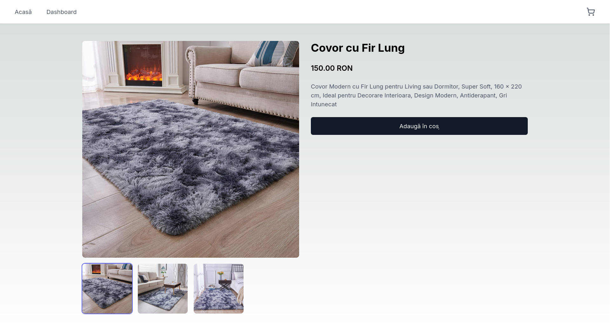
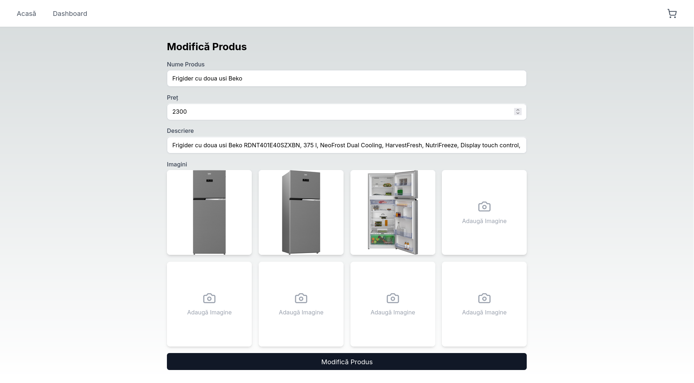
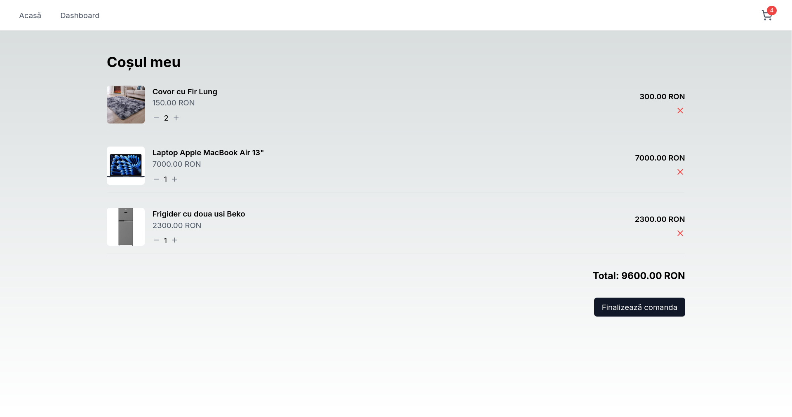
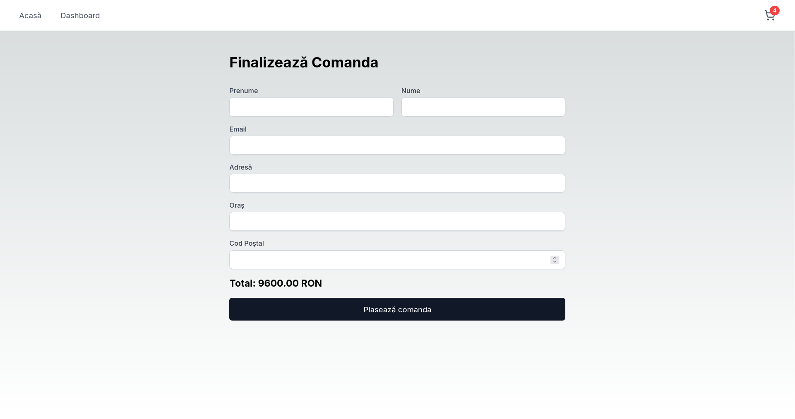
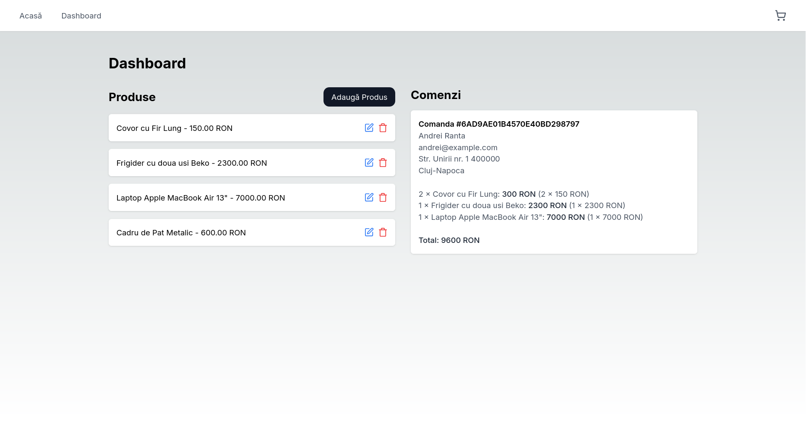

# High School Computer Certification ("Certificat de atestare a competențelor profesionale în domeniul informaticii")

## Online Store

**Created by:** Andrei Ranta

**Date:** February 2025

A functional, full-stack e-commerce application featuring:

* Product management (add, edit and remove products with titles, descriptions, prices, and images)
* Automatic thumbnail generation for optimized loading times
* Complete shopping cart functionality and order processing
* An administrative dashboard for monitoring placed orders
* Persistent database storage for all application data
* A fully responsive user interface

This project was developed during my final year of high school and achieved the maximum score for the certification exam.

## Tech Stack

* Next.js 15 (React v19)
* MongoDB
* Radix UI
* Zustand (State management)
* Sharp (Image processing)

## Running the Project

To preserve the original codebase and ensure compatibility with dependencies that may become deprecated over time, the application is containerized. Docker is required to run the project.

To build the image and start the application:

```bash
bash run+build.bash

```

To start the application without rebuilding the image:

```bash
bash run.bash

```

## Screenshots

| | |
|:---:|:---:|
|  |  |
|  |  |
|  |  |
|  | |